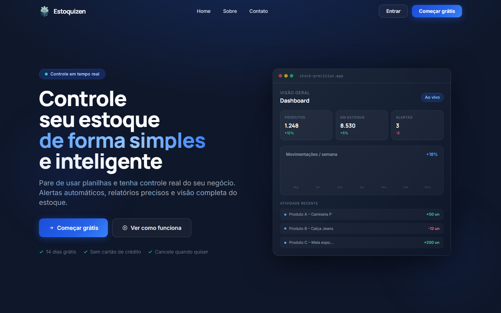
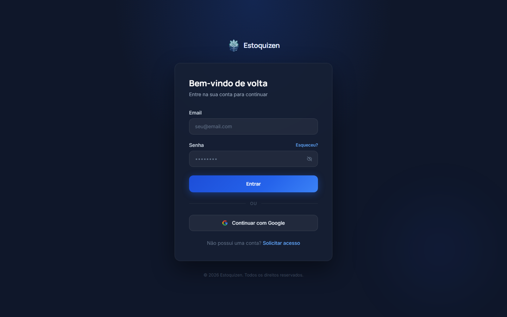

# Estoquizen — Frontend

Interface web do **Estoquizen**, um SaaS de gestão de estoque para pequenos negócios. Pelo navegador ou pelo celular, a equipe cadastra produtos, dá entrada e saída lendo o código de barras com a câmera, importa compras pelo QR code da NFC-e e acompanha o estoque em dashboards.

🔗 **Aplicação:** https://estoquizen.vercel.app  
⚙️ **API (backend):** [VictorGoms/Estoquizen-API](https://github.com/VictorGoms/Estoquizen-API)

<p align="center">
  
  
</p>

<!--
  Prints das telas internas: salve as imagens em docs/ e descomente as linhas abaixo.

<p align="center">
  
  
</p>
<p align="center">
  
  
</p>
<p align="center">
  
  
</p>
-->

---

## Funcionalidades

**Estoque**
- Lista de produtos com busca por nome ou código e filtro por situação: normal, baixo ou zerado (comparando com o estoque mínimo de cada produto).
- Cadastro manual. Ao informar o código de barras, a tela sugere o nome do produto consultando a base pública do Open Food Facts.
- Página do produto com edição, registro de entradas e saídas com motivo, histórico e foto. A imagem é comprimida no navegador (Canvas, máx. 800px) antes de ir para o Supabase Storage.

**Leitor de código de barras**
- Usa a câmera do celular ou do computador (ZXing) para dar entrada ou saída de um produto em poucos toques.
- Se o código não estiver cadastrado, abre o cadastro com o código já preenchido.

**Importar compra (NFC-e)**
- Três formas de entrada: ler o QR code do cupom fiscal, digitar a chave de 44 dígitos ou enviar o XML da nota.
- Tela de revisão antes de confirmar. Cada item aparece como **novo**, **existente** ou **divergente** (unidade ou preço diferente do cadastrado), e dá para ajustar quantidades ou remover itens.
- Ao confirmar, cria os produtos novos e lança entrada nos existentes.

**Dashboards**
- Início com indicadores (total de produtos, valor em estoque, alertas) e atividade recente.
- Métricas com filtro de período (7 dias, 30 dias, 3 meses): entradas, saídas, médias, gráfico de movimentações (Recharts) e distribuição do estoque.
- Central de notificações com produtos zerados ou abaixo do mínimo.

**Equipe e permissões**
- Convite de membros por e-mail, com fluxos para quem ainda não tem conta (definir senha) e para quem já tem (aceitar convite).
- Convites pendentes com opção de revogar.
- Três papéis por workspace. A interface se adapta ao papel do usuário:

  | Permissão | owner | admin | member |
  |---|:---:|:---:|:---:|
  | Ver estoque e dashboards | ✓ | ✓ | ✓ |
  | Editar estoque / importar NFC-e | ✓ | ✓ | |
  | Convidar e editar membros | ✓ | ✓ | |
  | Configurações do workspace | ✓ | ✓ | |
  | Encerrar assinatura | ✓ | | |

**Conta, empresas e planos**
- Login com e-mail e senha ou com Google, recuperação de senha e mensagens de erro em português.
- Um usuário pode participar de várias empresas (workspaces) e alternar entre elas.
- Onboarding em duas etapas: dados da empresa, depois escolha do plano (Basic, Growth com trial, Pro). Os planos pagos redirecionam para o checkout do Stripe.
- Configurações com plano atual, barra de uso do limite, acesso ao portal de assinatura do Stripe e encerramento da conta com confirmação.
- Perfil com foto (upload para o Supabase Storage).
- Sessão mantida por até 30 dias sem uso ("Manter conectado neste aparelho", o padrão). Em computador compartilhado, desmarcando a opção, a sessão acaba ao fechar o navegador ou após 2h de inatividade.

## Stack

| | |
|---|---|
| Framework | Next.js 16 (App Router) + React 19 |
| Linguagem | TypeScript (strict) |
| Estilo | Tailwind CSS 4 (tema próprio) |
| Auth / dados | Supabase JS (Auth, consultas com RLS, Storage) |
| Cache de dados | SWR |
| Gráficos | Recharts |
| Leitura de códigos | @zxing/browser (código de barras e QR code) |
| Deploy | Vercel |

## Como se conecta ao backend

- As chamadas para `/api/v1/*` passam por um *rewrite* do Next.js para a API Fastify (variável `API_URL`). Assim o navegador fala só com a origem do frontend, sem problema de CORS ou de *mixed content* quando acessado pelo celular em HTTPS.
- O cliente HTTP (`src/lib/api.ts`) injeta o token da sessão do Supabase em cada requisição.
- Login, leituras simples e upload de imagens usam o Supabase direto, protegidos pelas policies de Row Level Security do banco.
- Headers de segurança globais em `next.config.ts`: `X-Frame-Options`, `X-Content-Type-Options`, `Referrer-Policy` e `Permissions-Policy`.

## Como rodar localmente

**Pré-requisitos:** Node.js 20+, a [API](https://github.com/VictorGoms/Estoquizen-API) rodando em `http://localhost:3001` e o mesmo projeto Supabase usado por ela.

```bash
git clone https://github.com/VictorGoms/Estoquizen.git
cd Estoquizen
npm install
```

Crie um `.env.local` na raiz:

```env
NEXT_PUBLIC_SUPABASE_URL=https://SEU_PROJETO.supabase.co
NEXT_PUBLIC_SUPABASE_ANON_KEY=sua_anon_key
NEXT_PUBLIC_API_URL=/api/v1           # passa pelo proxy do Next
API_URL=http://localhost:3001         # destino do proxy (em produção, a URL da API)
```

O `npm run dev` sobe em **HTTPS**, porque a câmera só funciona em contexto seguro, inclusive pelo celular na rede local. Gere um certificado local com o [mkcert](https://github.com/FiloSottile/mkcert) antes:

```bash
mkcert -install
mkdir certs
mkcert -key-file certs/key.pem -cert-file certs/cert.pem localhost 127.0.0.1
npm run dev        # https://localhost:3000
```

Para gerar o build de produção: `npm run build` e depois `npm start`.

## Estrutura

```
src/
  app/          rotas (App Router): auth, onboarding, dashboard, estoque, nota, scanner, membros...
  components/   landing, auth, dashboard, nota (NFC-e), onboarding, ui (BarcodeScanner, loaders)
  hooks/        useRole (permissões), useWorkspace, useProducts, useStats, useAlertCount
  lib/          api (cliente HTTP), supabase, session (inatividade), sanitize, userContext
```

## Próximos passos

- Testes (componentes e fluxos principais com Playwright) e CI no GitHub Actions.
- Exportação do estoque em CSV.
- Concentrar na API as escritas que hoje vão direto ao Supabase, para que regras como o modo somente leitura de assinaturas expiradas valham em todos os fluxos.
- Arquivo `.env.example` e prints das telas internas neste README.

## Autor

**João Victor** · [GitHub](https://github.com/VictorGoms) · [LinkedIn](https://www.linkedin.com/in/jo%C3%A3o-victor-da-silva-gomes-a47315237)
